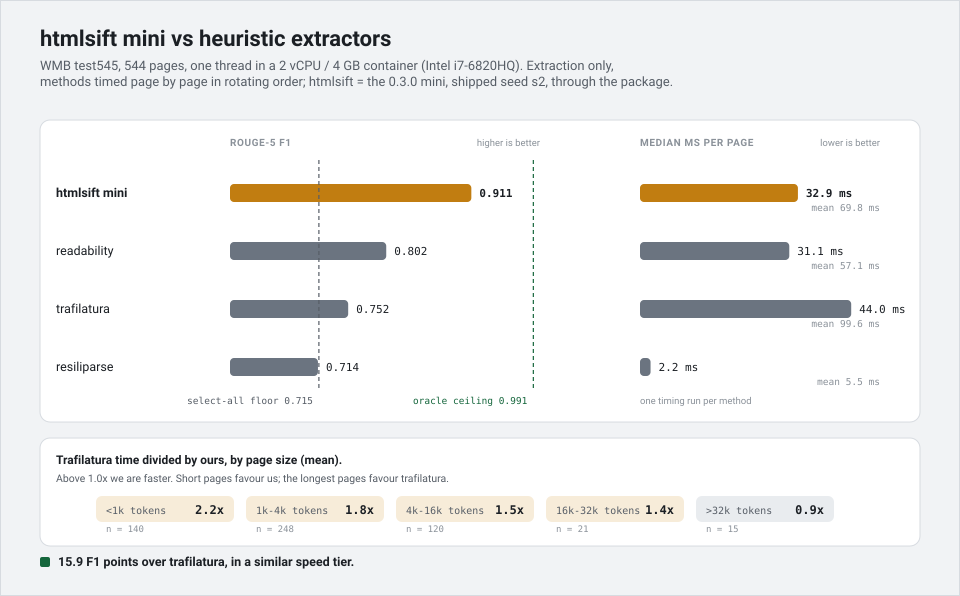
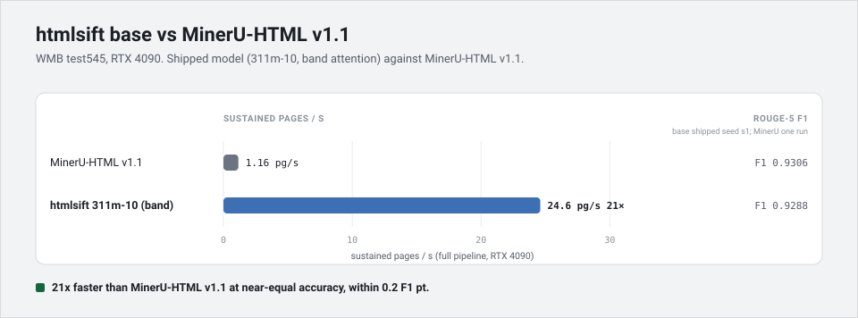
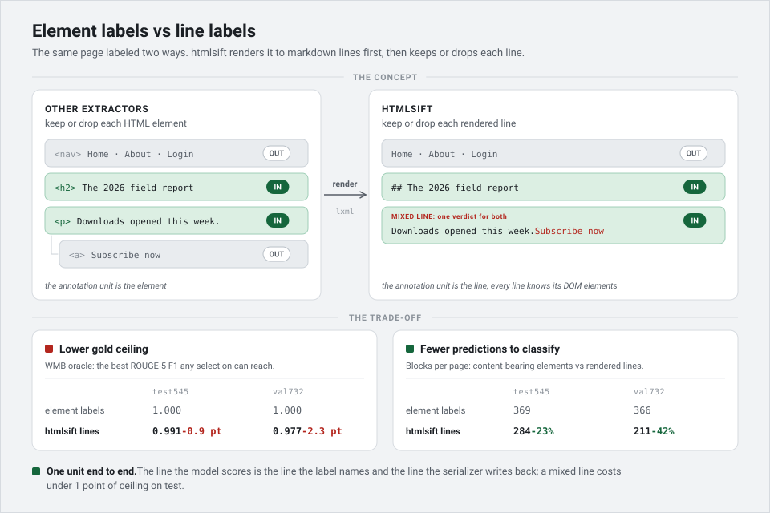
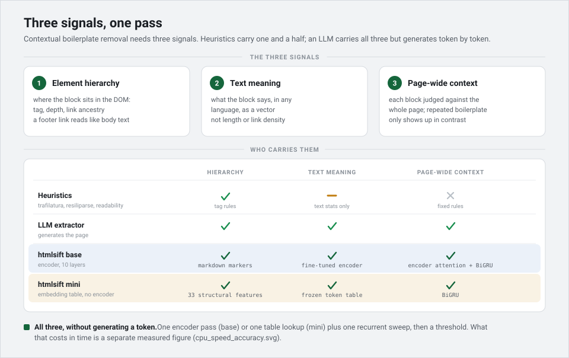
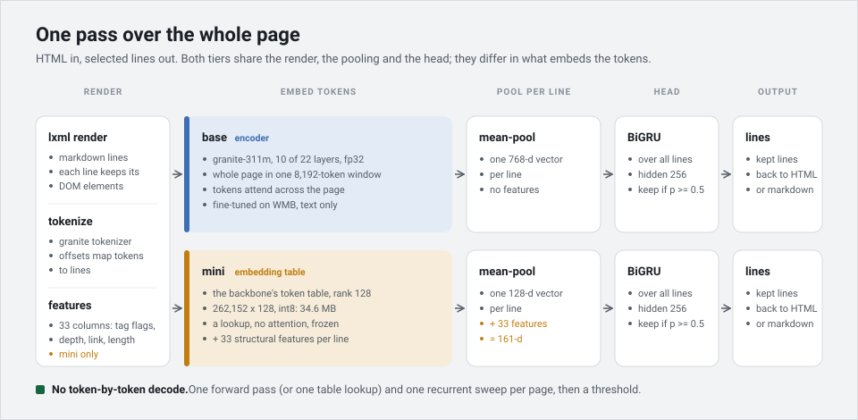
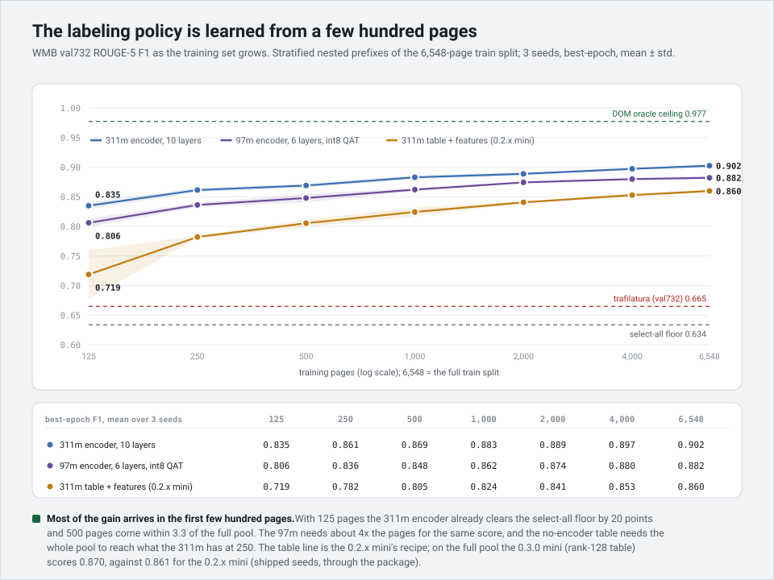

# htmlsift

[](https://pypi.org/project/htmlsift/)
[](https://pypi.org/project/htmlsift/)
[](LICENSE)
[](https://huggingface.co/koivualeksi/htmlsift-release)
[](https://huggingface.co/spaces/koivualeksi/htmlsift)

### Main content is a policy

Main-content extraction and boilerplate removal for web pages: raw HTML in, clean text, HTML
or markdown out, with nav, ads, cookie banners and footers stripped. For RAG and LLM data
pipelines, scraping and archiving.

What counts as main content depends on who is asking. Heuristic extractors such as
trafilatura and readability hard-code one answer in rules; htmlsift learns it from labelled
pages. It ships trained on [WebMainBench][wmb] (WMB), and a few dozen pages labelled your
way retrain it to yours.

Try it in the browser: [htmlsift on Hugging Face Spaces](https://huggingface.co/spaces/koivualeksi/htmlsift).

## Quick start

```bash
pip install htmlsift
```

```python
import htmlsift
text = htmlsift.extract(html)                    # main content as plain text
md = htmlsift.extract(html, output="markdown")   # or output="html"
```

Two models shipped, both trained on WMB (7,825 labelled pages, custom split 6,548 train /
732 val / 545 test):

- **`mini`** (default) - a fast int8-ONNX model that runs on CPU. `pip install htmlsift`
- **`base`** - a 311M encoder, most accurate and GPU-capable. `pip install htmlsift[full]`

Both are fully retrainable on your own labels. Training and the whole research suite are in
[htmlsift-research](https://github.com/koivualeksi/htmlsift-research).

[wmb]: https://github.com/opendatalab/WebMainBench

## A few dozen labelled pages teach it your policy

**Out of the box on WCXB articles, the shipped `mini` scores 0.918, below trafilatura's
0.937. Continue training it on 50 labelled articles and it passes every heuristic (0.940);
all 513 reach 0.956.**

The learning curve is measured on articles only. Page types with more varied layouts, such
as product or listing pages, are untested and may need more labelled pages.

When your idea of main content differs from WMB's, a few dozen labelled pages of one page
type are enough to retrain for it. Trained on N WCXB articles and scored on the 257 WCXB test
articles (word-F1):

| articles | `mini`, from the shipped model | `mini`, from scratch | `base`, from scratch | `base`, from the shipped model |
|---|---|---|---|---|
| 0 | 0.918 | — | — | 0.934 |
| 25 | 0.928 | 0.897 | 0.948 | 0.937 |
| 50 | 0.940 | 0.915 | 0.956 | 0.941 |
| 100 | 0.944 | 0.917 | 0.956 | 0.955 |
| 200 | 0.948 | 0.929 | 0.956 | 0.952 |
| 400 | 0.954 | 0.948 | 0.959 | 0.961 |
| 513 | 0.956 | 0.951 | 0.967 | 0.960 |

On the same 257 articles, with no training: trafilatura 0.937, readability 0.928,
resiliparse 0.815.

- **`mini`: start from the shipped model.** From 50 articles it beats every heuristic, and it
  keeps climbing to 0.956. Trained from scratch it is behind at every size.
- **`base`: start from scratch.** It is ahead up to 50 articles and ahead or level after,
  likely because the full encoder has absorbed WMB's policy more deeply than the mini's small
  head, so unlearning it costs more than starting clean (untested).
- Most columns flatten from about 100–200 articles.

Articles are the page type where heuristics are strongest: zero-shot, trafilatura beats both
shipped models here. Training pages come from other sites than the test pages, and the 155
test articles from sites with no training page score the same or higher. This is one page
type across many sites; learning a single site from a few of its own pages is untested.
`mini` columns are 3-seed means, `base` columns one seed, so `base` gaps under ~0.01 are
not resolvable. Recipes and the per-site split are in
[htmlsift-research](https://github.com/koivualeksi/htmlsift-research)
(`results/wcxb-article-ladder.md`).

## Results

| model | desc | WMB test F1 | CPU (pages/s) | GPU (pages/s) | install |
|---|---|---|---|---|---|
| `base` | 311M, 10 layers | **0.9288** | — | 24.6 | `htmlsift[full]` |
| `mini` | int8 rank-128 embedding table | 0.9114 | **30.4** | — | `htmlsift` |

* F1 = the shipped model run through this package, WMB test: 544 pages (one of the 545 test
  pages has no gold reference and is skipped in scoring).
* CPU = one thread in a 2 vCPU / 4 GB Docker container (Intel i7-6820HQ). `base` is a GPU
  model and is not timed on CPU.
* GPU = RTX 4090.

### On CPU



One CPU thread, WMB test (544 pages), extraction only, all four extractors in the same
2 vCPU / 4 GB container, timed page by page in rotating order. `mini` scores ~16 F1 points
above trafilatura at heuristic speed: trafilatura takes 1.3x mini's median time (44.0 vs
32.9 ms), readability is about level, and resiliparse is ~15x faster but markedly less
accurate. The win is accuracy at heuristic speed, not speed.

| extractor | median ms | pages/s | WMB F1 | RAM after load | worst page |
|---|---|---|---|---|---|
| `mini` | 32.9 | 30.4 | **0.9114** | 401 MB | 576 MB |
| trafilatura | 44.0 | 22.7 | 0.7525 | 48 MB | 285 MB |
| readability | 31.1 | 32.2 | 0.8016 | 34 MB | 134 MB |
| resiliparse | 2.2 | 453.6 | 0.7135 | 26 MB | 87 MB |

RAM after load is a process holding only that extractor, after loading it and running one
page; worst page is the largest single-page peak over the fold. A 1 vCPU / 2 GB container
gives the same ratios.

### On GPU



RTX 4090, WMB test (544 pages). `base` sustains 24.6 pages/s against
MinerU-HTML v1.1's 1.16: a 21x gap at near-equal accuracy (F1 0.9288 vs 0.9306).

### Cross benchmark accuracy

The shipped models are trained on WMB, so WMB is in-domain. The other two columns are
**zero-shot**, the model never saw WCXB or the multilingual DAnIEL in training. Each column is
scored with that benchmark's own metric. The `base` recipe leads every heuristic here; `mini`
is ~0.6 points behind trafilatura on WCXB, level with readability on DAnIEL, and ahead of the
rest — see **Annotation is a policy** under Concept.

| model | WMB (ROUGE-5) | WCXB (word-F1, zero-shot) | DAnIEL (ROUGE-L, zero-shot) |
|---|---|---|---|
| `base` recipe, 3 seeds | 0.9311 | 0.8633 | 0.9175 |
| `mini` | 0.9114 | 0.8529 | 0.8925 |
| trafilatura | 0.7525 | 0.8584 | 0.8255 |
| readability | 0.8016 | 0.7653 | 0.8904 |
| resiliparse | 0.7135 | 0.7909 | 0.7094 |

`mini` is the shipped model through this package. The `base` row is the research mean of the
recipe's three seeds; the shipped seed is scored on WMB only (0.9288). Heuristics are single
deterministic runs.

## When not to use it

- **Off-policy pages with nothing to retrain on.** Zero-shot on benchmarks labelled under
  other policies, `mini` is about level with the best heuristic. The clear lead is on WMB's
  policy, or on one you train it on.
- **Tight memory.** `mini` holds ~400 MB once loaded, where the heuristic extractors take a
  few tens of MB, and a very large page can exhaust a 1–2 GB machine (see Memory below).
- **Raw speed above all.** `mini` runs at heuristic speed; resiliparse is an order of
  magnitude faster, at markedly lower accuracy.

## Installation

```bash
pip install htmlsift          # default: the mini model (CPU, ONNX)
pip install htmlsift[full]    # adds the base 311M model (torch; GPU-capable)
```

- **`htmlsift`** — the `mini` model only; few dependencies (onnxruntime + tokenizers + lxml +
  numpy + huggingface-hub + w3lib). First use downloads ~43 MB of model files.
- **`htmlsift[full]`** — adds `torch` + `transformers` to run `base`. First use of `base`
  downloads ~1 GB.

Requires Python 3.10+. Model files download from the Hugging Face Hub on first use and are
cached; prefetch with `htmlsift download mini` (or `base`), or set `HF_HUB_OFFLINE=1` to run
from cache only.

### Memory (`mini`)

- **Fixed:** the Python process takes ~400 MB once the model is loaded.
- **Per page:** memory grows with the page: parsing and rendering, plus about 12 KB per
  rendered line and 1 KB per distinct token for inference. A typical page (100–200 KB of
  HTML) adds about 5 MB; a 5 MB page with 16,000 rendered lines adds up to ~280 MB.
- **Release:** a page estimated above 100 MB of inference memory (about 8,500 rendered lines)
  hands it back to the system when it finishes, so one large page doesn't leave a
  long-running worker big.
- **Small machines:** page size has no built-in limit, so a very large page can exhaust
  RAM on a 1–2 GB machine. Cap the input size before calling `extract()`.

## Usage

```python
from htmlsift import Extractor

ex = Extractor()                     # defaults to "mini"
ex.extract(html)                     # -> str (plain text)
ex.extract(html, output="html")      # keep structure, links, images
ex.extract(html, output="markdown")  # clean markdown: [text](url), 
ex.extract(html, with_blocks=True)   # -> (blocks, probs) for callers who want each line and its prediction individually
```

Module-level convenience (cached singleton):

```python
import htmlsift
htmlsift.extract(html)               # default mini
```

The larger model, from the `[full]` install:

```python
ex = Extractor("base")               # 311M encoder; uses the GPU when one is present,
                                     # else CPU (with a warning)
ex = Extractor("base", device="cuda")  # require the GPU (errors if none is available)
ex = Extractor("base", device="cpu", threads=4)  # force CPU; `threads` sets parallelism
```

`mini` is CPU-only (int8 ONNX); asking it for a GPU raises. Only `base` runs on the GPU.

### Bytes and encodings

Pass raw bytes from a file, an HTTP response or a WARC record, and htmlsift decodes them:

```python
ex.extract(response.content)                       # charset from the page itself
ex.extract(payload, encoding="windows-1251")       # charset from the HTTP / WARC header
```

The charset is taken from, in order: a byte order mark, `encoding=`, the page's
`<meta charset>`; an undeclared page is read as utf-8, falling back to cp1252. Unknown
labels are skipped and undecodable bytes become `�`. A `str` counts as already decoded, so
`encoding=` with a `str` raises `TypeError`. Prefer passing bytes over a `str` decoded
upstream: `requests`' `response.text`, for one, guesses ISO-8859-1 for pages without a
charset header.

### Absolute links

Pass the page's URL to make links and image URLs absolute in `html` and `markdown` output:

```python
ex.extract(html, output="markdown", base_url="https://example.com/blog/post")
# [the report](report)  ->  [the report](https://example.com/blog/report)
```

The page's first `<base href>` is resolved against `base_url`, as a browser does. Without
`base_url`, an absolute `<base href>` is used on its own; with neither, links stay as they
are. Malformed links are left unchanged. `text` output has no links, so it ignores
`base_url`.

### Page title

Most pages start their main content with the page title. `drop_title=True` leaves it out,
as text extractors for pretraining corpora usually do (they keep the title as metadata):

```python
ex.extract(html, drop_title=True)
```

The first selected line is dropped when it comes from an `h1`–`h6` or `p` element whose
whole text is that line, and it matches the page's `<title>` or `og:title` (case and
punctuation ignored, similarity at least 0.8 against the whole title or a part split at
` | `, ` - `, ` – `, ` : ` and similar separators). Any other first line is kept. It
applies to `text`, `html` and `markdown`; `with_blocks=True` is unchanged. The title is
kept by default.

### Repeated lines

Some pages hold the same text twice: a standfirst repeated as the first paragraph, mobile
and desktop copies of a block, a template that renders the article twice. The model
keeps such repeats, and the repetition filters of pretraining pipelines then reject the
whole page. `dedup=True` keeps only the first copy:

```python
ex.extract(html, dedup=True)
```

Each selected line of 100 or more characters that repeats an earlier selected line is
dropped. Lines are compared as letters and digits only: case, punctuation and heading
or list markers are ignored. Shorter lines
(headings, captions, "Read more") are always kept, and so are the lines of a `<pre>`,
where repeats are usually real. A line counts as a first copy only if it is selected. It
applies to `text`, `html` and `markdown`; `with_blocks=True` is unchanged. It is off by
default.

### Threshold

The model scores each line from 0 to 1, and a line is kept when its score is above
`threshold` (default 0.5). Lower keeps more, higher keeps less:

```python
ex.extract(html, threshold=0.3)
```

It is a precision/recall dial: only the default 0.5 is benchmarked, so the published
scores hold for 0.5 alone. It applies to `text`, `html` and `markdown`, and to the lines
`drop_title` and `dedup` look at; `with_blocks=True` returns every score unthresholded.

### Output modes

| `output` | what you get |
|---|---|
| `text` (default) | selected content as plain text: no heading, emphasis, code, quote, rule or fence markers; list bullets, ordered-list numbers and table rows (`\| a \| b \|`) stay |
| `html` | selected DOM, with structure / links / images kept |
| `markdown` | clean markdown, links and images preserved |

`html` and `markdown` output are cleaned of active content: the elements the model never
reads (`script`, `style`, `title`, `meta`, `link`, `base`) and SVG `<animate>` / `<set>`
are dropped; `on*` event handlers and `srcdoc` are removed; a link or source whose scheme
is not `http`, `https`, `mailto`, `tel` or `ftp` loses its target (`javascript:`,
`data:` and app links such as `sms:`), its text stays. Relative links and `data:image/`
in `` are kept. This is a basic cleanup, not a guarantee: run a full sanitizer
such as [nh3](https://github.com/messense/nh3) before inserting the output into a web page.

The lines exactly as the model scored them, markdown markers included, come from
`with_blocks=True`:

```python
blocks, probs = ex.extract(html, with_blocks=True)
scored = "\n".join(b for b, p in zip(blocks, probs) if p > 0.5)
```


## Command line

```bash
htmlsift extract page.html                          # main content of one page
htmlsift extract page.html --output markdown --base-url https://example.com/page
curl -s https://example.com/a | htmlsift extract - --base-url https://example.com/a
htmlsift extract "crawl/*.html" > out.jsonl         # one JSON record per file
htmlsift extract "crawl/**/*.html" --mode base --device cuda > out.jsonl
htmlsift --version                                  # htmlsift, Python and backend versions
```

One file or `-` (stdin) prints the content itself. Several files or a glob print one JSON
line per file, `{"path": ..., "content": ...}`, or `{"path": ..., "error": ...}` for a file
that failed; the run continues and exits with 1 at the end. Pass `--jsonl` to get records
for a single file too, which scripts should do: bash expands an unquoted `*.html` before
htmlsift sees it. Quoted globs are expanded by htmlsift itself (`**` recurses), so they
work the same in every shell; directories are not walked.

| flag | |
|---|---|
| `--output text\|html\|markdown` | as `output=` above (default `text`) |
| `--mode mini\|base`, `--device` | model and torch device, as for `Extractor` |
| `--base-url URL` | make links absolute; applies to every input |
| `--encoding ENC` | charset of the input bytes; applies to every input |
| `--drop-title` | leave out the leading page title, as `drop_title=True` |
| `--dedup` | leave out repeated lines, as `dedup=True` |
| `--threshold T` | keep lines scored above `T`, as `threshold=` (default 0.5) |
| `--jsonl` | always print JSON records |

Files are read as bytes, so the charset is detected as described above. Output is utf-8.
Exit codes: 0 ok, 1 a file or the model failed, 2 a usage error. In Windows PowerShell 5.1,
`>` re-encodes a program's output; redirect from bash, cmd or PowerShell 7 instead.

## Concept

<details>
<summary><b>How it works</b></summary>

### Line level labeling


Most extractors decide keep-or-drop on HTML *elements*. htmlsift first renders the page to
markdown *lines*, then decides keep-or-drop on each line. The trade-off is in the figure above, a line-based ceiling sits below the element level gold ceiling but there are far fewer units to classify per page.

### HTML 'signals' utilized

- **Where it sits**: in the DOM - tag, nesting depth, whether it's inside a link.
- **What it says**: a multilingual embedding of the line's tokens.
- **The whole-page context**: repeated boilerplate only stands out in contrast to the rest
  of the page, so every line is judged against all the others by a BiGRU.



Heuristic extractors carry the first one and a half of these; an LLM carries all three but
pays to generate the page token by token. htmlsift carries all three in one pass, and outputs predictions without needing a decoder.



Both tiers share the render, the per-line pooling, and the BiGRU head. They differ only in the text processing section
- mini converts text to tokens and mean-pools them, has no internal attention allowing fast CPU processing
- base uses granite r2 311m embedder using only first 10 layers requiring GPU for efficient usage 


</details>

<details>
<summary><b>Annotation is a policy</b></summary>


htmlsift learns what counts as main content from a benchmark's labels, so it's most accurate on pages that follow that policy. On WebMainBench (the benchmark the shipped models train on) it beats the common heuristic extractors by a wide margin. Zero-shot on benchmarks with different policies, the gap narrows: the 311M `base` recipe still edges every heuristic tested (trafilatura, readability, resiliparse) on both WCXB and DAnIEL. `mini` is ~0.6 points behind trafilatura on WCXB and level with readability on DAnIEL, and clears the other two on each. No heuristic is strong on both boards.

Train htmlsift on a different policy and it turns around. Fit it to WCXB instead of WMB and it tops WCXB but loses points on other benchmarks. For example when training `base` model on WCXB data, WMB falls to 0.8479, DAnIEL to 0.8826 while WCXB climbs up to 0.9209. Whichever policy you train on, htmlsift leads there and pays for it elsewhere.

For more information, review the [htmlsift-research](https://github.com/koivualeksi/htmlsift-research) readme.

</details>

<details>
<summary><b>Training and retraining</b></summary>

Most of the accuracy arrives in the first few hundred labelled pages — the model learns a
benchmark's labelling policy quickly, so retraining on your own labels is cheap. On one page
type a few dozen pages are enough (see **A few dozen labelled pages teach it your policy**
above).



These models were trained in the **htmlsift-research** repository. To reproduce the boards or
retrain on your own data, see [htmlsift-research](https://github.com/koivualeksi/htmlsift-research)
and its `docs/REPRODUCE.md`.

</details>

<details>
<summary><b>Known limits</b></summary>

A standalone hero image that is its own block renders to no text line, so it can't be selected
today. Inline images inside a kept block are preserved in `html` and `markdown`.

`base_url` does not rewrite `srcset`, so responsive images in `html` output keep relative
candidates (`src` is rewritten; `markdown` uses only `src`).

</details>

## License

Apache-2.0. See [LICENSE](LICENSE).

Model weights are distributed from the Hugging Face Hub, also under Apache-2.0, and are
trained on [WebMainBench](https://github.com/opendatalab/WebMainBench) (Apache-2.0); please
attribute WebMainBench when you use them.

## References

- **WMB — WebMainBench.** The training benchmark; ROUGE-5 main-content metric.
  Liu et al., *Dripper: Token-Efficient Main HTML Extraction with a Lightweight LM*.
  [arXiv:2511.23119](https://arxiv.org/abs/2511.23119) ·
  [repo](https://github.com/opendatalab/WebMainBench)
- **WCXB — Web Content Extraction Benchmark.** Foley, *WCXB: A Multi-Type Web Content Extraction
  Benchmark*. [arXiv:2605.21097](https://arxiv.org/abs/2605.21097) ·
  [repo](https://github.com/Murrough-Foley/web-content-extraction-benchmark)
- **DAnIEL.** Multilingual news corpus (Mutuvi et al.,
  [LREC 2020](https://aclanthology.org/2020.lrec-1.509/)); main-content scoring follows
  *Multilingual Evaluation of Main Content Extractors for Web Pages*, SIGIR 2025
  ([ACM](https://dl.acm.org/doi/10.1145/3726302.3730234)).

